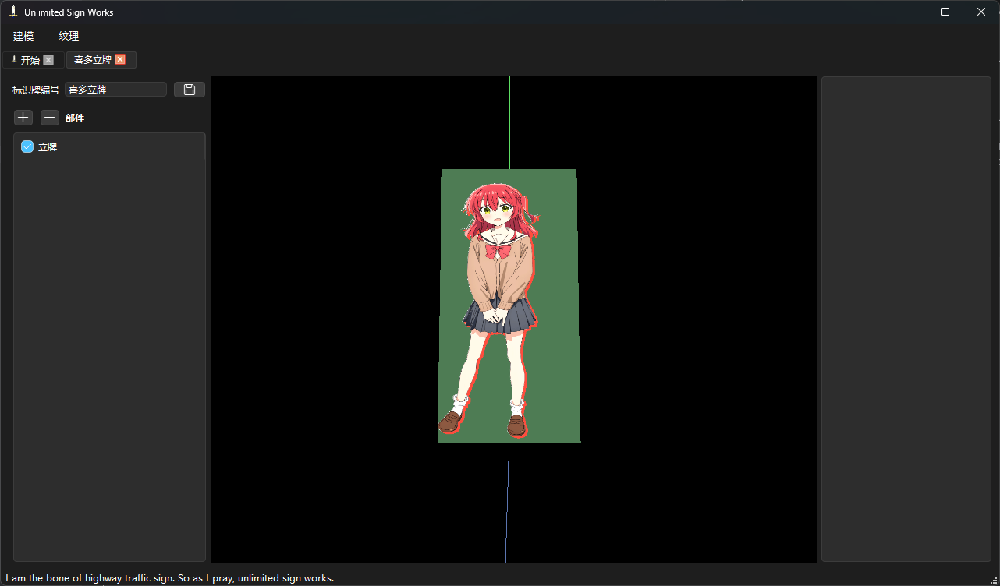
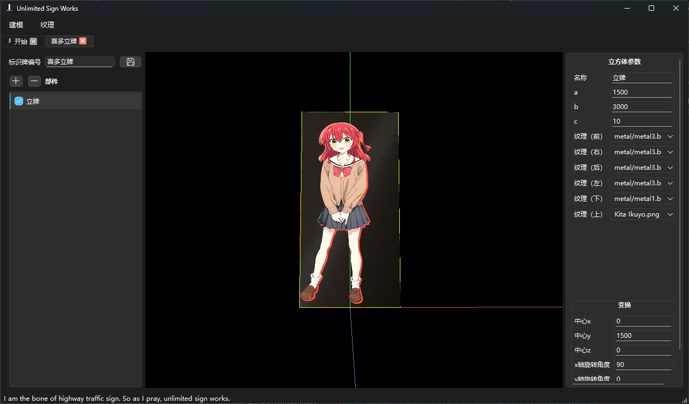

# 遇到的问题

颜色预乘处理

png 图片 alpha 为 0 的像素，其 rgb 不一定是 0，因此直接使用 rgb 计算光照，会使得图片中在图片查看其中透明的部分显示其真正的像素值。

错误处理：

```glsl
void main()
{
    vec3 texColor = texture(tex, TexCoord);
    
    // 环境光计算
    vec3 ambient = ambientColor * texColor;
    
    // 漫反射计算
    vec3 norm = normalize(Normal);
    vec3 lightDirNorm = normalize(vec3(lightPos - FragPos));  // 指向光源方向
    float diff = max(dot(norm, lightDirNorm), 0.0);
    vec3 diffuse = diff * lightColor * texColor;

    // 最终颜色合成
    vec3 result = ambient + diffuse;
    gl_FragColor = vec4(result, 1.0);
}
```



因此，需要做预乘或者使用 alpha 通道作为最终颜色的透明度。



